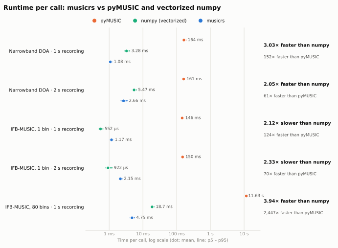

# musicrs

Rust implementation of MUltiple SIgnal Classification (MUSIC), described by R. O. Schmidt
([paper](http://ieeexplore.ieee.org/xpl/articleDetails.jsp?arnumber=1143830)), for
Direction-of-Arrival (DOA) estimation with microphone arrays.

It is a port of [pyMUSIC](https://github.com/amjadsaadeh/pyMUSIC), the implementation written
for empirical investigations of MUSIC in my master thesis. Pure Rust, no LAPACK.

## Features

- Narrowband MUSIC: covariance → noise subspace (Hermitian eigendecomposition via `faer`) →
  pseudo-spectrum `1 / ‖Eₙᴴ a(θ)‖²` → peak picking.
- Multi-source peak picking (circular local maxima, highest first). pyMUSIC's
  `getSourceAngles` clustered all estimates around the first peak; this is fixed here.
- IFB-MUSIC (wideband): per-bin cross-spectral matrices from an STFT, narrowband spectra
  combined by geometric mean.
- FFT-based analytic signal (Hilbert transform) and STFT helpers.

## Usage

```rust
use musicrs::MusicEstimator;
use nalgebra::DMatrix;

// Default: Kinect 4-mic linear array, 720 angle steps over [0, 2π), 16 kHz
let estimator = MusicEstimator::default();

// 4 × N real-valued microphone samples, e.g. read from a WAV file
let data: DMatrix<f64> = /* ... */;

// Narrowband DOA of one 1400 Hz source, in radians
let angles = estimator.estimate_doa_from_real(&data, 1, 1400.0)?;

// Wideband: IFB-MUSIC spectrum over chosen STFT bins (nfft = 160 → 100 Hz bins)
let (spectrum, angles) = estimator.ifb_music_spectrum(&data, 160, 1, Some(&[14]))?;
```

Bad input (wrong channel count, NaN, silence, too many sources, an unusable angle grid, …)
is returned as a `MusicError`.

For other arrays use `MusicEstimator::new(antenna_positions, angle_steps_num, search_interval,
sample_rate)` with `[x, y]` positions in metres. If you already have complex (analytic) data,
call `estimate_doa` directly.

### Things to keep in mind

- A linear array cannot distinguish θ from 360° − θ; restrict `search_interval` to [0, π]
  if you want a single answer.
- IFB-MUSIC only sees frequencies up to Nyquist (`sample_rate / 2`); a tone recorded above
  Nyquist is aliased and its DOA cannot be recovered from the STFT bins.
- Running IFB-MUSIC over *all* bins on a narrowband signal is dominated by noise-only bins;
  select the bins that carry signal energy.

## Performance vs pyMUSIC and numpy

<picture>
  <source media="(prefers-color-scheme: dark)" srcset="docs/benchmark-dark.svg">
  
</picture>

The same calls on the same recordings (1400 Hz, 40°), from the real-valued samples to the
result, in three implementations:

- **pyMUSIC**, run unmodified;
- **numpy (vectorized)**, pyMUSIC's algorithm written the way numpy is meant to be used
  ([`bench/bench_numpy.py`](bench/bench_numpy.py)): the same analytic signal,
  `np.linalg.eig` and steering vectors, but in `float64`, with all 720 angles in one array
  operation, on one thread. Before timing, its spectra are checked against pyMUSIC's (relative
  difference below 1e-7, same peak);
- **musicrs**, single-threaded.

**Against pyMUSIC, musicrs is 12× to 2,129× faster, but that is not a Rust-vs-Python
result.** Almost all of pyMUSIC's time goes to a Python loop that builds the 720 steering
vectors one element at a time in software-emulated `float128`, with `np.matrix` products.
That loop costs ~140–160 ms per pseudo-spectrum whatever the recording length, and IFB-MUSIC
needs one spectrum per bin. Written idiomatically, the same algorithm in numpy takes
milliseconds.

**Against vectorized numpy, musicrs is 2.1× to 2.9× slower on narrowband DOA and single-bin
IFB-MUSIC, and 3.5× faster on IFB-MUSIC over 80 bins.** With one spectrum per call, most of
the time goes to work that grows with the recording (the times roughly double from 1 s to
2 s): the Hilbert transform or STFT and the covariance. numpy runs these in optimised C/BLAS
kernels over whole arrays, and musicrs's own versions of them are likely where it loses
(not yet profiled). Over 80 bins, the per-bin work of 80
eigendecompositions and 80 spectra dominates, and numpy pays Python and call overhead for each
one.

| Workload | Implementation | n | Mean ± stddev | Median | p5 – p95 | CV | musicrs speedup (mean) |
|---|---|---:|---:|---:|---:|---:|---:|
| Narrowband DOA · 1 s recording | pyMUSIC | 200 | 160 ms ± 6.59 ms | 159 ms | 151 ms – 174 ms | 4.1% | 25× |
|  | numpy (vectorized) | 1000 | 3.03 ms ± 263 µs | 2.95 ms | 2.78 ms – 3.55 ms | 8.7% | 0.48× |
|  | musicrs | 1000 | 6.29 ms ± 699 µs | 6.03 ms | 5.58 ms – 7.46 ms | 11.1% |  |
| Narrowband DOA · 2 s recording | pyMUSIC | 200 | 158 ms ± 6.69 ms | 156 ms | 151 ms – 173 ms | 4.2% | 12× |
|  | numpy (vectorized) | 1000 | 5.02 ms ± 536 µs | 4.84 ms | 4.45 ms – 6.14 ms | 10.7% | 0.38× |
|  | musicrs | 1000 | 13.4 ms ± 938 µs | 13 ms | 12.5 ms – 15.2 ms | 7.0% |  |
| IFB-MUSIC, 1 bin · 1 s recording | pyMUSIC | 200 | 144 ms ± 5.94 ms | 142 ms | 139 ms – 157 ms | 4.1% | 129× |
|  | numpy (vectorized) | 1000 | 512 µs ± 44 µs | 502 µs | 466 µs – 594 µs | 8.6% | 0.46× |
|  | musicrs | 1000 | 1.12 ms ± 79 µs | 1.1 ms | 1.05 ms – 1.26 ms | 7.1% |  |
| IFB-MUSIC, 1 bin · 2 s recording | pyMUSIC | 200 | 149 ms ± 6.33 ms | 147 ms | 145 ms – 163 ms | 4.2% | 60× |
|  | numpy (vectorized) | 1000 | 855 µs ± 105 µs | 819 µs | 753 µs – 1.07 ms | 12.3% | 0.35× |
|  | musicrs | 1000 | 2.48 ms ± 181 µs | 2.5 ms | 2.04 ms – 2.66 ms | 7.3% |  |
| IFB-MUSIC, 80 bins · 1 s recording | pyMUSIC | 30 | 11.56 s ± 256 ms | 11.58 s | 11.27 s – 11.91 s | 2.2% | 2,129× |
|  | numpy (vectorized) | 1000 | 18.8 ms ± 1.82 ms | 18.2 ms | 17 ms – 22.4 ms | 9.7% | 3.46× |
|  | musicrs | 1000 | 5.43 ms ± 553 µs | 5.46 ms | 4.73 ms – 6.21 ms | 10.2% |  |

*musicrs speedup*: the row's mean time over musicrs's; below 1× musicrs is slower. Every call
is timed separately (pyMUSIC: 200 calls per case, 30 for 80 bins; numpy and musicrs: 1000)
after 3 warm-up calls, the three implementations one after the other on an otherwise idle
machine. Machine: Intel N150 (3 cores), Linux, `performance` governor, rustc 1.88, Python
3.10 / numpy 1.23.5 (OpenBLAS, one thread); see [`bench/`](bench/README.md) for the harnesses
and how to reproduce, and [`bench/results/`](bench/results/) for the raw samples.

### Distribution of the timings

<picture>
  <source media="(prefers-color-scheme: dark)" srcset="docs/benchmark-distribution-dark.svg">
  
</picture>

- **Not normal.** Shapiro-Wilk rejects normality for every case (p < 0.01; p < 0.001 for all
  but pyMUSIC over 80 bins, which has only 30 calls), on t and on log t. Most distributions
  are right-skewed (skew up to 3.6): a sharp edge near the fastest call and a tail of slower
  ones, the shape of interference that can only add time. A log-normal fits better than a
  normal in all cases but one, but none is log-normal either.
- **Scheduling moves the mean by a few percent.** The mean is at most 4.3 % above the median,
  and the outliers (calls slower than median + 3 robust sigmas) raise the mean by at most
  2.9 % (*tail excess*). Mean and median give the same ratios to within a few percent.
  Because the distributions are skewed, ± stddev overstates the spread below the mean; the
  p5 – p95 column shows the real range.
- **Slow calls come in runs.** Lag-1 autocorrelation is 0.2 to 0.9, so neighbouring calls are
  alike. Isolated preemptions would hit calls independently; runs point to slower changes in
  machine state (CPU frequency, caches, the core the process runs on). It is clearest for
  musicrs: over 80 bins its calls fall into two clusters, ~4.8 ms and ~6 ms (autocorrelation
  0.87, drift −14 %), and with one bin on the 2 s recording a group of calls near 0.83 times
  the median gives a drift of +25 %. These two cases are near-symmetric rather than skewed.
- **Run to run**, a shorter musicrs run an hour earlier gave means up to 17 % lower. Read the
  numbers as about ± 20 %. The ratios between musicrs and numpy (2× to 3.5×) are larger than
  that, the ratios to pyMUSIC far larger.

<details>
<summary>Shape statistics per case</summary>

| Workload | Implementation | Shape | Skew | Excess kurtosis | Shapiro p (t / log t) | (Mean − median) / median | Outliers | Tail excess | Lag-1 autocorr. | Drift |
|---|---|---|---:|---:|---:|---:|---:|---:|---:|---:|
| Narrowband DOA · 1 s recording | pyMUSIC | right-skewed, not normal (closer to log-normal) | 0.93 | 1.0 | 6.9e-08 / 6.8e-07 | +0.2% | 5.5% | +0.6% | 0.52 | +4.2% |
|  | numpy (vectorized) | right-skewed, heavy tail, not normal (closer to log-normal) | 2.14 | 5.7 | 6.2e-34 / 5.5e-31 | +2.6% | 6.1% | +1.7% | 0.52 | -0.4% |
|  | musicrs | right-skewed, heavy tail, not normal (closer to log-normal) | 1.81 | 6.8 | 5.9e-30 / 8.9e-26 | +4.2% | 2.3% | +0.9% | 0.66 | +7.1% |
| Narrowband DOA · 2 s recording | pyMUSIC | right-skewed, not normal (closer to log-normal) | 1.31 | 1.9 | 3.6e-11 / 2.4e-10 | +1.2% | 5.5% | +0.6% | 0.51 | -4.5% |
|  | numpy (vectorized) | right-skewed, not normal (closer to log-normal) | 1.22 | 1.0 | 2.6e-27 / 1.1e-24 | +3.8% | 5.5% | +1.6% | 0.75 | +6.0% |
|  | musicrs | right-skewed, heavy tail, not normal (closer to log-normal) | 2.56 | 16.8 | 5.5e-34 / 6.4e-31 | +2.5% | 12.2% | +2.1% | 0.67 | -0.4% |
| IFB-MUSIC, 1 bin · 1 s recording | pyMUSIC | right-skewed, heavy tail, not normal (closer to log-normal) | 2.31 | 5.7 | 1e-18 / 3.3e-18 | +1.5% | 18.0% | +1.7% | 0.39 | -2.7% |
|  | numpy (vectorized) | right-skewed, heavy tail, not normal (closer to log-normal) | 1.74 | 4.2 | 6.6e-30 / 9.5e-27 | +2.0% | 3.5% | +1.0% | 0.71 | -6.4% |
|  | musicrs | right-skewed, heavy tail, not normal (closer to log-normal) | 3.63 | 28.5 | 5.9e-37 / 7.1e-33 | +2.0% | 4.8% | +1.0% | 0.45 | -0.1% |
| IFB-MUSIC, 1 bin · 2 s recording | pyMUSIC | right-skewed, heavy tail, not normal (closer to log-normal) | 2.31 | 5.8 | 2.9e-18 / 1.1e-17 | +1.7% | 15.0% | +1.6% | 0.52 | -2.8% |
|  | numpy (vectorized) | right-skewed, not normal (closer to log-normal) | 1.53 | 2.6 | 5.9e-30 / 9.9e-27 | +4.3% | 5.8% | +2.1% | 0.76 | -3.9% |
|  | musicrs | near-symmetric, heavy tail, not normal (closer to normal) | 0.25 | 10.0 | 8.6e-34 / 9.8e-34 | -0.7% | 1.9% | +0.5% | 0.65 | +24.7% |
| IFB-MUSIC, 80 bins · 1 s recording | pyMUSIC | right-skewed, not normal (closer to log-normal) | 0.97 | 1.1 | 0.0043 / 0.0057 | -0.2% | 0.0% | +0.0% | 0.18 | -1.2% |
|  | numpy (vectorized) | right-skewed, heavy tail, not normal (closer to log-normal) | 2.57 | 11.7 | 8.2e-35 / 7.3e-31 | +3.0% | 12.1% | +2.9% | 0.70 | -1.6% |
|  | musicrs | near-symmetric, not normal (closer to log-normal) | 0.42 | -0.2 | 2.4e-24 / 6.1e-24 | -0.7% | 0.2% | +0.1% | 0.87 | -13.6% |

*Outliers*: calls slower than median + 3 · 1.4826 · MAD. *Tail excess*: mean of all calls
over the mean without the outliers. *Drift*: mean of the last 10 % of calls over the first 10 %.

</details>

## Differences from pyMUSIC

| | pyMUSIC | musicrs |
|---|---|---|
| Eigendecomposition | `np.linalg.eig` (general) | Hermitian solver (`faer`), orthonormal noise basis |
| Sign convention | conjugated analytic signal, `exp(−j2πfτ)` | non-conjugated analytic signal, `exp(+j2πfτ)` (equivalent) |
| Multi-source peaks | broken (see TODO in `getSourceAngles`) | circular local maxima |
| IFB default bins | all, including DC | all except DC |
| Precision | `float128` steering vectors | `f64` |

On nearly noiseless data the noise eigenvalues are degenerate (~1e-15) and `np.linalg.eig`
returns a non-orthogonal noise basis, so pyMUSIC's spectrum values depend on that arbitrary
basis (≈9 % on the test data); its peak locations are unaffected.

## Development

```sh
cargo test                                  # unit, doc and integration tests
cargo clippy --all-targets -- -D warnings
cargo fmt --check
```

Test data in `tests/data/single-source/` are 4-channel, 24-bit, 16 kHz WAV recordings named
`single-source_<freq>Hz_<doa>deg_<duration>s.wav`. `tests/golden_test.rs` checks parity with
spectra produced by the original pyMUSIC code; see `tests/golden/generate_golden.py` to
regenerate them.

`examples/bench_pymusic.rs` and `bench/` hold the runtime benchmark against pyMUSIC; see
[`bench/README.md`](bench/README.md).

## License

MIT
