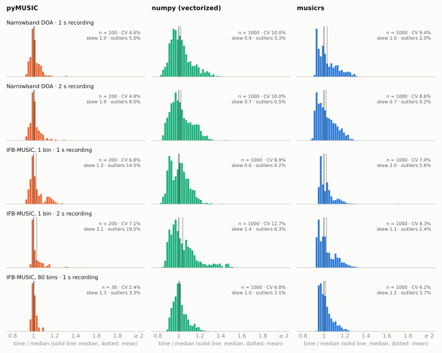

# musicrs

Rust implementation of MUltiple SIgnal Classification (MUSIC), described by R. O. Schmidt
([paper](http://ieeexplore.ieee.org/xpl/articleDetails.jsp?arnumber=1143830)), for
Direction-of-Arrival (DOA) estimation with microphone arrays.

It is a port of [pyMUSIC](https://github.com/amjadsaadeh/pyMUSIC), the implementation written
for empirical investigations of MUSIC in my master thesis. Pure Rust, no LAPACK.

## Features

- Narrowband MUSIC: covariance → noise subspace (Hermitian eigendecomposition via `faer`) →
  pseudo-spectrum `1 / ‖Eₙᴴ a(θ)‖²` → peak picking.
- Multi-source peak picking (circular local maxima, highest first). pyMUSIC's
  `getSourceAngles` clustered all estimates around the first peak; this is fixed here.
- IFB-MUSIC (wideband): per-bin cross-spectral matrices from an STFT, narrowband spectra
  combined by geometric mean.
- FFT-based analytic signal (Hilbert transform) and STFT helpers.

## Usage

```rust
use musicrs::MusicEstimator;
use nalgebra::DMatrix;

// Default: Kinect 4-mic linear array, 720 angle steps over [0, 2π), 16 kHz
let estimator = MusicEstimator::default();

// 4 × N real-valued microphone samples, e.g. read from a WAV file
let data: DMatrix<f64> = /* ... */;

// Narrowband DOA of one 1400 Hz source, in radians
let angles = estimator.estimate_doa_from_real(&data, 1, 1400.0);

// Wideband: IFB-MUSIC spectrum over chosen STFT bins (nfft = 160 → 100 Hz bins)
let (spectrum, angles) = estimator.ifb_music_spectrum(&data, 160, 1, Some(&[14]));
```

For other arrays use `MusicEstimator::new(antenna_positions, angle_steps_num, search_interval,
sample_rate)` with `[x, y]` positions in metres. If you already have complex (analytic) data,
call `estimate_doa` directly.

### Things to keep in mind

- A linear array cannot distinguish θ from 360° − θ; restrict `search_interval` to [0, π]
  if you want a single answer.
- IFB-MUSIC only sees frequencies up to Nyquist (`sample_rate / 2`); a tone recorded above
  Nyquist is aliased and its DOA cannot be recovered from the STFT bins.
- Running IFB-MUSIC over *all* bins on a narrowband signal is dominated by noise-only bins;
  select the bins that carry signal energy.

## Performance vs pyMUSIC

<picture>
  <source media="(prefers-color-scheme: dark)" srcset="docs/benchmark-dark.svg">
  
</picture>

The same calls on the same recordings (1400 Hz, 40°), from the real-valued samples to the
result, with pyMUSIC run unmodified. musicrs is **14× to 784× faster** by mean time per call.
pyMUSIC spends ~140 ms per pseudo-spectrum building 720 `float128` steering vectors in a
Python loop, whatever the recording length, so the gap is widest for IFB-MUSIC (one spectrum
per bin) and narrows for longer recordings, where musicrs's own work (Hilbert transform,
covariance) grows with the sample count.

| Workload | Implementation | n | Mean ± stddev | Median | p5 – p95 | CV | Speedup (mean) |
|---|---|---:|---:|---:|---:|---:|---:|
| Narrowband DOA · 1 s recording | pyMUSIC | 200 | 159 ms ± 8.03 ms | 158 ms | 150 ms – 173 ms | 5.0% |  |
|  | musicrs | 1000 | 5.63 ms ± 570 µs | 5.41 ms | 5.1 ms – 6.73 ms | 10.1% | 28× |
| Narrowband DOA · 2 s recording | pyMUSIC | 200 | 163 ms ± 18.9 ms | 157 ms | 151 ms – 205 ms | 11.6% |  |
|  | musicrs | 1000 | 11.7 ms ± 832 µs | 11.5 ms | 11 ms – 13.7 ms | 7.1% | 14× |
| IFB-MUSIC, 1 bin · 1 s recording | pyMUSIC | 200 | 144 ms ± 7.19 ms | 142 ms | 139 ms – 157 ms | 5.0% |  |
|  | musicrs | 1000 | 757 µs ± 121 µs | 770 µs | 633 µs – 845 µs | 16.0% | 191× |
| IFB-MUSIC, 1 bin · 2 s recording | pyMUSIC | 200 | 152 ms ± 6.85 ms | 151 ms | 143 ms – 164 ms | 4.5% |  |
|  | musicrs | 1000 | 1.24 ms ± 94 µs | 1.22 ms | 1.15 ms – 1.44 ms | 7.5% | 122× |
| IFB-MUSIC, 80 bins · 1 s recording | pyMUSIC | 30 | 11.53 s ± 244 ms | 11.43 s | 11.30 s – 11.83 s | 2.1% |  |
|  | musicrs | 1000 | 14.7 ms ± 748 µs | 14.5 ms | 13.9 ms – 16.4 ms | 5.1% | 784× |

Every call is timed separately (pyMUSIC: 200 calls per case, 30 for 80 bins; musicrs: 1000)
after 3 warm-up calls. Machine: Intel N150 (3 cores), Linux, `performance` governor, rustc
1.88, Python 3.10 / numpy 1.23.5; see [`bench/`](bench/README.md) for the harnesses and how to
reproduce, and [`bench/results/`](bench/results/) for the raw samples.

### Distribution of the timings

<picture>
  <source media="(prefers-color-scheme: dark)" srcset="docs/benchmark-distribution-dark.svg">
  
</picture>

- **Not normal.** Shapiro-Wilk rejects normality for every case (p < 0.001), on t and on
  log t. Every distribution is right-skewed (skew 1.1 to 3.2, and 16.6 for one case with a
  single 5× outlier): a sharp edge near the fastest call and a tail of slower ones, the shape
  of interference that can only add time. A log-normal fits better than a normal in every
  case, but none is log-normal either.
- **Scheduling moves the mean by a few percent.** The mean is at most 4.2 % above the median,
  and the outliers (calls slower than median + 3 robust sigmas) raise the mean by at most
  3.8 % (*tail excess*). Mean and median give the same speedups to within a few percent.
  Because the distributions are skewed, ± stddev overstates the spread below the mean; the
  p5 – p95 column shows the real range.
- **Slow calls come in runs.** Lag-1 autocorrelation is 0.3 to 0.7, so neighbouring calls are
  alike. Isolated preemptions would hit calls independently; runs point to slower changes in
  machine state (CPU frequency, caches, the core the process runs on). It is clearest for
  musicrs IFB-MUSIC with one bin on the 1 s recording: two clusters, ~650 µs and ~790 µs. A
  re-run reproduced both clusters, in a different order.
- **Run to run**, a second musicrs run gave means 3 to 8 % different. Read the numbers as
  about ± 10 %; the speedups are far larger than that.

<details>
<summary>Shape statistics per case</summary>

| Workload | Implementation | Shape | Skew | Excess kurtosis | Shapiro p (t / log t) | (Mean − median) / median | Outliers | Tail excess | Lag-1 autocorr. | Drift |
|---|---|---|---:|---:|---:|---:|---:|---:|---:|---:|
| Narrowband DOA · 1 s recording | pyMUSIC | right-skewed, heavy tail, not normal (closer to log-normal) | 2.15 | 7.9 | 1.1e-13 / 5.1e-12 | +0.8% | 2.5% | +0.5% | 0.46 | +6.5% |
|  | musicrs | right-skewed, heavy tail, not normal (closer to log-normal) | 2.13 | 11.4 | 7e-33 / 1.5e-29 | +4.0% | 10.3% | +2.5% | 0.72 | -0.3% |
| Narrowband DOA · 2 s recording | pyMUSIC | right-skewed, heavy tail, not normal (closer to log-normal) | 2.93 | 9.6 | 1.2e-20 / 3.1e-19 | +4.2% | 12.5% | +3.8% | 0.61 | +18.1% |
|  | musicrs | right-skewed, heavy tail, not normal (closer to log-normal) | 1.94 | 4.4 | 1.4e-33 / 1.5e-31 | +2.4% | 11.0% | +2.1% | 0.68 | +3.2% |
| IFB-MUSIC, 1 bin · 1 s recording | pyMUSIC | right-skewed, heavy tail, not normal (closer to log-normal) | 3.23 | 15.3 | 1.4e-19 / 1.4e-18 | +1.8% | 15.5% | +1.7% | 0.41 | +0.3% |
|  | musicrs | right-skewed, heavy tail, not normal (closer to log-normal) | 16.60 | 419.5 | 1.6e-48 / 3.2e-33 | -1.8% | 0.6% | +0.7% | 0.30 | +18.2% |
| IFB-MUSIC, 1 bin · 2 s recording | pyMUSIC | right-skewed, not normal (closer to log-normal) | 1.13 | 1.4 | 3e-09 / 2.9e-08 | +0.5% | 2.5% | +0.4% | 0.50 | +4.5% |
|  | musicrs | right-skewed, not normal (closer to log-normal) | 1.51 | 2.1 | 2.5e-30 / 2.3e-28 | +2.4% | 7.7% | +1.6% | 0.72 | -3.3% |
| IFB-MUSIC, 80 bins · 1 s recording | pyMUSIC | right-skewed, heavy tail, not normal (closer to log-normal) | 1.66 | 3.9 | 0.00034 / 0.00055 | +0.9% | 3.3% | +0.3% | 0.35 | +1.1% |
|  | musicrs | right-skewed, not normal (closer to log-normal) | 1.44 | 2.1 | 1.5e-27 / 1.1e-25 | +1.2% | 6.1% | +0.9% | 0.69 | -1.8% |

*Outliers*: calls slower than median + 3 · 1.4826 · MAD. *Tail excess*: mean of all calls
over the mean without the outliers. *Drift*: mean of the last 10 % of calls over the first 10 %.

</details>

## Differences from pyMUSIC

| | pyMUSIC | musicrs |
|---|---|---|
| Eigendecomposition | `np.linalg.eig` (general) | Hermitian solver (`faer`), orthonormal noise basis |
| Sign convention | conjugated analytic signal, `exp(−j2πfτ)` | non-conjugated analytic signal, `exp(+j2πfτ)` (equivalent) |
| Multi-source peaks | broken (see TODO in `getSourceAngles`) | circular local maxima |
| IFB default bins | all, including DC | all except DC |
| Precision | `float128` steering vectors | `f64` |

On nearly noiseless data the noise eigenvalues are degenerate (~1e-15) and `np.linalg.eig`
returns a non-orthogonal noise basis, so pyMUSIC's spectrum values depend on that arbitrary
basis (≈9 % on the test data); its peak locations are unaffected.

## Development

```sh
cargo test                                  # unit, doc and integration tests
cargo clippy --all-targets -- -D warnings
cargo fmt --check
```

Test data in `tests/data/single-source/` are 4-channel, 24-bit, 16 kHz WAV recordings named
`single-source_<freq>Hz_<doa>deg_<duration>s.wav`. `tests/golden_test.rs` checks parity with
spectra produced by the original pyMUSIC code; see `tests/golden/generate_golden.py` to
regenerate them.

`examples/bench_pymusic.rs` and `bench/` hold the runtime benchmark against pyMUSIC; see
[`bench/README.md`](bench/README.md).

## License

MIT
